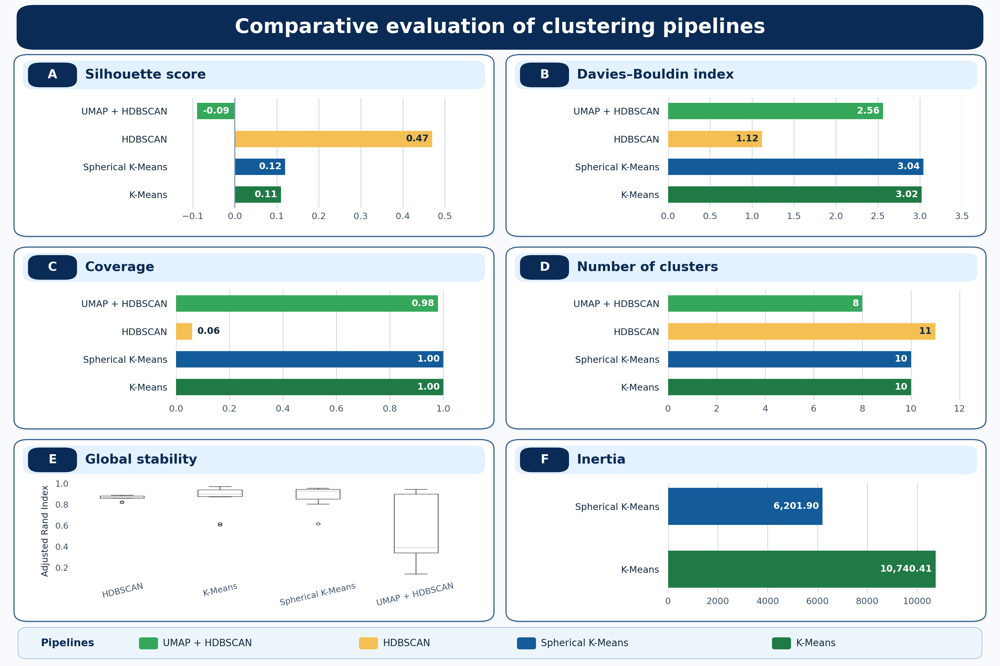

# Supply Chain MLOps - Client reviews unsupervised clustering 

This project stems from a collective work produced in the context of [Liora Machine Learning engineering formation](https://liora.io/formation/data-ia/machine-learning-engineer). The current version of it has been reframed entirely for learning purposes.
This work has been both an organizational and technical challenge. Both aspects are documented in the present README file.

## Technicalities

The main purpose was to implement the complete MLops chain from project design up to production and monitoring of the application and models. The starting point was 40 000 scrapped Trustpilot reviews.
We aimed at implementing a clustering tool enabling automatic reviews clustering coupled with sentiment analysis. This reframed version of the project is focused on unsupervised semantic clustering only.
The main point is to display the stability and structure of the whole MLops chain. 

### Rebuild step 1: Exploratory phase

Four pipelines were explored during this exploratory phase. Using SentenceTransformers paraphrase-multilingual-mpnet-base-v2 to generate embeddings (with L2 normalization):
* [KMeans](https://digicoll.lib.berkeley.edu/record/113015?utm_source=chatgpt.com&v=pdf)
* [Spherical KMeans](https://link.springer.com/article/10.1023/A:1007612920971)
* [HDBSCAN](https://dl.acm.org/doi/10.1145/2733381)
* [UMAP dimensional reduction](https://arxiv.org/abs/1802.03426) followed by HDBSCAN

All pipelines were tracked using MLflow. Geometric, semantic, statistical and algorithmic coherence and stability have been investigated.
 
**Conclusions:**

Both silhouette score and Davies-Bouldin index indicate the best clustering method to be HDBSCAN. KMeans and Spherical KMeans yield consistent and similar clusters geometry with silhouette scores close to 0.1. According to the [original publication](https://www.sciencedirect.com/science/article/pii/0377042787901257?via%3Dihub), silhouette score < 0.25 indicates an absence of significant structures in the clustering. However, in the context of very high dimensional spaces clustering associated to semantic analysis, it is common to find such values. [This paper](https://peerj.com/articles/cs-2078/) from 2024 on short-text clustering using the same type of embeddings presents satisfying clustering results associated with silhouette scores around 0.1.

Geometric quality of the clusters is not enough by itself. Other indicators such as the coverage and the number of clusters produced can be even more relevant especially when we consider the business relevance of the product. In our fictif TrustPilot tool case scenario, we are looking for a method allowing for maximal coverage and around 10 clusters so it can stay user friendly. In this regard, HDBSCAN is definitely out of the scope. Dimension reduction with UMAP ameliorates the coverage very significantly, however the number of clusters cannot be fixed such as for KMeans or Spherical KMeans. Moreover, HDBSCAN do not possess a predict() method hence bringing additionnal complications for the production and inference stage.

[Adjusted rand index](https://link.springer.com/article/10.1007/BF01908075) computations on several seeds and subsets of the initial dataset indicate good and well converged overall stability of both HDBSCAN, KMeans and Spherical Kmeans. As expected from its deterministic nature, HDBSCAN is hence the most stable algorithm while UMAP reduction introduces significant variability in the results.

The clusters where semantically annotated using [c-TF-IDF method](https://arxiv.org/abs/2203.05794) and manually inspected: KMeans and Spherical KMeans are associated with the best semantic coherences. Altogether, these results indicate a clear advantage for KMeans and Spherical KMeans for this semantic clustering project. Interestingly enough, [Spherical KMeans algorithm was initially developped to tackle specifically this type of large sparse text data clustering](https://link.springer.com/article/10.1023/A:1007612920971). Based on inertia, Spherical KMeans appear more geometrically defined than traditionnal KMeans however semantic coherence was a little bit more satisfying for KMeans. Hence, both algorithms will be tested in the next stages. 
