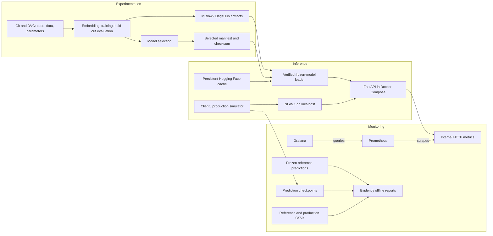

# Supply Chain MLOps — Customer Review Clustering

A reproducible machine learning pipeline for organizing customer reviews into
semantic clusters, serving a frozen model, and observing its operational behavior.
The project connects experimentation to local deployment and independent final
assessment. Cluster IDs are assignments, not sentiment labels or validated topics.

**Observed outcomes:** 8,000 production reviews processed without failed requests
or retries; a single final geometric evaluation on 2,261 reviews; an exploratory
100-review human inspection. These results support an applied MLOps demonstration,
not a public production service or a claim of semantic accuracy.

See [verified results and limitations](docs/final_validation.md),
[reproduction commands](docs/reproduction.md), and the
[repository consolidation audit](docs/repository_audit.md).

## Architecture



Training fits estimators only on the training split. Inference reuses the selected
encoder and estimator. Operational monitoring observes HTTP behavior; offline
statistical monitoring compares distributions. Final evaluation and manual
inspection assess the same frozen model without feeding results back into selection.

## Technology stack

| Tool | Role |
|---|---|
| Python 3.12 / uv | Environment management and locked dependencies |
| SentenceTransformers / NumPy / scikit-learn | Embeddings, clustering and geometry |
| Git / DVC | Code, data pointers, pipeline dependencies and experiments |
| MLflow / DagsHub | Experiment metadata and versioned model artifacts |
| FastAPI / Uvicorn | Typed inference API |
| Docker Compose / NGINX | Local service orchestration and reverse proxy |
| Prometheus / Grafana | HTTP metrics, scrape health and provisioned dashboards |
| Evidently 0.7.23 / SciPy | Offline distribution reports and statistical tests |
| pytest / Matplotlib | Synthetic regression tests and evaluation figures |

The custom Spherical KMeans implementation is in [src/train.py](src/train.py).
KMeans and Spherical KMeans are the supported experiment methods. The dependency
lock also retains libraries used by earlier exploratory notebooks.

## Repository structure

```text
config/selection.docker.json  Portable selected-model reference
src/
  embed.py, train.py          Experiment embedding and training stages
  predict.py, evaluate.py     Frozen inference and held-out evaluation
  experiment.py              Shared data, identity and provenance contracts
  run_experiments.py         DVC experiment orchestration
  select_best.py             Multi-seed selection workflow
  tracking.py                Local/environment MLflow configuration
  api/                       FastAPI application and bounded metrics
  simulate_production.py     Sequential replay, checkpoints and resume
  monitor_drift.py           Reference prediction and offline drift workflow
  evaluate_final.py          Sealed, execution-once final evaluation
  sample_semantic_inspection.py  Local human-inspection sample
monitoring/                  Prometheus and Grafana configuration
nginx/                       Reverse proxy configuration
notebooks/                   Historical exploration; saved outputs removed
tests/                      Offline tests and opt-in integration tests
docs/                       Reproduction, aggregate validation and audit
```

`Dockerfile`, `compose.yaml`, `params.yaml`, `dvc.yaml`, `dvc.lock`,
`pyproject.toml` and `uv.lock` define the existing execution environment.
`src/select_model.py` is an earlier single-result ranking entry point; the current
multi-seed workflow uses `src/select_best.py`.

## Data and reproducibility

Customer review CSVs are private DVC-managed inputs, not Git source files.
Access requires the configured data remote and appropriate credentials.

| Dataset | Purpose | Observations used |
|---|---|---:|
| `data/train_eval/train_20k.csv` | Estimator training | 20,000 |
| `data/train_eval/eval_4k.csv` | Model-selection evaluation | 4,000 |
| `data/processed/avis_4k_reference.csv` | Monitoring baseline | 4,000 |
| `data/processed/avis_8k_production.csv` | Production replay | 8,000 |
| `data/processed/avis_3k_test.csv` | Reserved final evaluation | **2,261** |

The filename “3k” is nominal: the actual final file has 2,261 reviews. All were
retained. The monitoring reference and the model-selection evaluation are distinct
cohorts with different roles.

Git tracks source, configuration, lock files and DVC pointers. DVC manages private
data and pipeline outputs; MLflow manages model/run artifacts separately.
`reports/`, `mlruns/`, model caches, local databases and credentials are ignored.
A Git checkout alone does not include the private data, trained weights or runtime
evidence. DVC/Git remotes are preserved; credentials belong in ignored local
configuration or the environment.

The loader verifies selected logical ID, manifest/run identity, model SHA-256,
encoder revision, preprocessing and estimator parameters. Final evaluation also
seals source hashes, software versions and dataset fingerprints. The current
`params.yaml` experiment entry is the last explored configuration, **not** the
selected serving model; serving uses `config/selection.docker.json`.

**Reproducibility caveat:** the current DVC status reports changed dependencies and
a missing MPNet embedding cache relative to recorded pipeline state. No lock or
training output was regenerated during consolidation. See the
[audit](docs/repository_audit.md) before attempting a cached reproduction.

## Experimentation and model selection

The scripted comparison evaluated two pinned multilingual encoders, two clustering
methods and five seeds: 20 configurations. Selection maximized mean held-out cosine
silhouette; ARI broke exact ties. The final seed, 42, was predetermined. The proposed
future refit on all 24,000 development reviews was **not executed**.

Selected model:

- Encoder: `sentence-transformers/paraphrase-multilingual-mpnet-base-v2`.
- Revision: `4328cf26390c98c5e3c738b4460a05b95f4911f5`; max sequence length 128.
- Preprocessing: strip/reject blank text; L2-normalized float32 embeddings.
- Spherical KMeans: 10 clusters, seed 42, `n_init=10`, `max_iter=300`.
- Mean selection silhouette over five seeds: **0.117329**; inter-seed standard
  deviation **0.000054**. This aggregate is not an individual final-test baseline.

Logical model ID:
`c93cb37fac6cbebb9f3cce20cb962722c0190a5e588afffbb80f6512eebafab0`

Model SHA-256:
`0576bf251a3b4daad93598bc971669d32b18e71d9fd5a9b1b98034486ca3f4af`

The DagsHub training run is `c650a6675bf5438c81d90b96ee4e154c`.
No model is retrained or selected at API startup.

## Inference API

Use NGINX at `http://127.0.0.1:8080` for the Compose deployment.

| Endpoint | Behavior |
|---|---|
| `GET /health` | 200 when the model is ready; 503 otherwise |
| `POST /predict` | Review texts → cluster assignments and logical model ID |
| `GET /model/info` | Selected encoder, revision, method, seed and preprocessing version |
| `GET /docs` | Interactive OpenAPI documentation |

Request: 1–64 nonblank strings, each at most 5,000 characters. Extra fields are
rejected. Requests in a single process serialize access to the shared predictor.
The three fixed control sentences below are API fixtures, not published customer data.

```json
{"texts":["Livraison rapide et produit conforme","Commande jamais reçue","Service client très réactif"]}
```

Verified response for the selected model:

```json
{
  "predictions": [{"cluster_id": 6}, {"cluster_id": 7}, {"cluster_id": 6}],
  "model_id": "c93cb37fac6cbebb9f3cce20cb962722c0190a5e588afffbb80f6512eebafab0"
}
```

Ready health response:

```json
{"status":"ok","model_ready":true,"model_status":"ready"}
```

Model information fields are `model_id`, `encoder_id`, `encoder_revision`, `method`,
`random_seed`, `preprocessing_version`. Missing model readiness produces 503 for
inference/model information; schema errors produce 422 and prediction failures 500.

## Local deployment

[Reproduction instructions](docs/reproduction.md) cover installation, private data
retrieval, host API startup, Compose and tests. The existing API image is
`supply-chain-inference:local`; public service/base images are digest-pinned.

Runtime credentials are separate from image builds:

| Setting | Use |
|---|---|
| `MLFLOW_TRACKING_USERNAME` plus `DAGSHUB_USER_TOKEN` or `MLFLOW_TRACKING_PASSWORD` | DagsHub artifact access |
| `SUPPLY_CHAIN_TRACKING_URI` | Optional override of the selected tracking store |
| `SUPPLY_CHAIN_SELECTION_PATH` | Selection JSON path seen by the API |
| `SUPPLY_CHAIN_SELECTION_FILE` | Host selection bind-mount source in Compose |
| `SUPPLY_CHAIN_ENV_FILE` | Optional host tracking environment file |
| `HF_HOME`, `HF_HUB_OFFLINE` | Encoder cache location and optional cache-only use |
| `GF_SECURITY_ADMIN_USER`, `GF_SECURITY_ADMIN_PASSWORD` | Initial Grafana administrator |

Copy the provided blank templates to ignored local files and fill them privately.
Compose service `env_file` values supply container credentials; Compose interpolation
variables must be exported or passed with `--env-file`. They are different mechanisms.

NGINX publishes `127.0.0.1:8080`; Prometheus `127.0.0.1:9090`; Grafana
`127.0.0.1:3000`. The API's port 8000 is internal. Persistent named volumes retain
Hugging Face, Prometheus and Grafana data. The Docker build context is allowlisted;
private data, reports and credentials are excluded.

An observed cold initialization took **1,045.67 s**, dominated by Hugging Face/Xet
acquisition/reconstruction, exceeding the old 660-second wait budget. This is a
known startup limitation, not fixed by this documentation. Healthcheck settings
are unchanged. Cached operation was validated; no cold-start SLA is claimed.

## Operational and statistical monitoring

Prometheus scrapes `http://api:8000/metrics` internally every 15 seconds.
NGINX blocks public metrics paths. Metrics have bounded method/route/status labels:
`http_requests_total`, `http_request_duration_seconds`, `http_requests_in_progress`,
and `model_ready`. HTTP durations include preprocessing, inference, queueing and
response handling; pure model latency is not separately instrumented.

Grafana provisions **API Performance** and **Model Serving Health** dashboards.
Anonymous access is disabled. Dashboards were verified through their datasource,
provisioning and query APIs; this does not establish browser rendering quality.

The sequential production simulator validates row IDs/model identity, writes each
completed request attempt to checkpoints and supports resume. A network interruption
can leave an uncertain in-flight request; HTTP delivery is not exactly-once.
Completed checkpoint records are not silently duplicated on resume.

Offline monitoring derives character length and whitespace word count. KS statistics
and Pearson categorical homogeneity statistics are permutation-calibrated with
1,999 resamples and seed 42; Holm adjusts the three available tests. Evidently
exports distributions and supplementary distances; the machine-readable protocol
results distinguish significance from practical effect. Drift is not performance
or semantic-quality evaluation.

## Verified operational results

| Phase 6E controlled workload | Observation |
|---|---:|
| Reference predictions | 4,000/4,000 |
| Production predictions | 8,000/8,000 |
| Sequential production batches | 500 × 16 reviews |
| Failed prediction requests / retries | 0 / 0 |
| Throughput, including 1 s inter-batch delay | **10.37 reviews/s** |
| Mean client batch latency | **0.541 s** |
| p95 client batch latency | **0.718 s** |

These measurements describe one controlled local run, not maximum throughput,
realistic concurrent traffic, a per-review latency or an SLA guarantee.
Prometheus and Grafana observed the expected 500 prediction requests.

## Drift results

| Reference → production | Effect size | Holm-adjusted p | Provisional practical threshold |
|---|---:|---:|---:|
| Review length | KS D = 0.03650 | 0.0015 | 0.1 |
| Word count | KS D = 0.03725 | 0.0015 | 0.1 |
| Cluster distribution | Total variation = 0.04938 | 0.0015 | 0.1 |

Differences were statistically significant and below the provisional practical
thresholds. No model degradation was demonstrated. Exchangeability assumptions,
author/time dependence and Monte Carlo resolution limit interpretation.

## Final geometric evaluation

One approved execution on all **2,261** final observations used frozen predicted
labels, normalized embeddings and original training centroids.

| Metric | Observed value |
|---|---:|
| Exact cosine silhouette | **0.111541** |
| Mean assigned-centroid similarity | **0.738337** |
| Mean dispersion, 1 − cosine | **0.261663** |
| Mean margin to next-best centroid | **0.089303** |
| Represented clusters | **10/10**, none empty |

The modest silhouette indicates limited geometric separation; it is not a semantic
accuracy score. No compatible individual historical result or justified uncertainty
interval was substituted for missing evidence.

Final IDs do not overlap development/monitoring IDs, but **127 final reviews** have
stripped text matching training reviews and **76** match model-selection reviews.
These groups can overlap. All were retained. Complete content-level independence
and a complete historical non-use guarantee cannot be claimed.

## Exploratory human inspection

A deterministic 100-review sample contains 10 reviews per cluster: 4 high assigned
similarities, 3 near the cluster median, and 3 low assignment margins, with seed 42
for ties and no repeated stripped text within a cluster. Original texts and individual
annotations remain in a private ignored CSV. The [annotation guide and sampling
workflow](docs/reproduction.md#semantic-inspection) support repeatable local inspection.

One human annotator proposed themes and assessed coherence for **all 100 sampled
reviews**. As clarified by the project owner, each populated coherence cell records
a collective judgment for the corresponding ten-review cluster sample. The ten
cluster-level judgments are **5 good, 4 excellent and 1 average**. They cover the
100 reviews through grouped assessment, rather than 100 independent per-review
ratings. The preliminary owner summary was “good to very good.” Ambiguity and
comment fields are blank; this does not establish an absence of ambiguity.

The targeted, equal-quota sample overrepresents small clusters and selected geometric
cases. It cannot estimate unbiased global accuracy. No new semantic labels, themes
or interpretations were generated during consolidation.

## Limitations and next steps

- Limited geometric separation; no ground-truth semantic labels or validated accuracy.
- Imperfect content independence and possible author/time dependence.
- One exploratory annotator using collective cluster-level coherence judgments;
  no independent per-review ratings or inter-rater agreement assessment.
- Statistical drift does not establish operational importance or model degradation.
- Controlled sequential load and localhost deployment, rather than a public service
  tested under concurrent traffic.
- Slow initial encoder downloads, stale/missing DVC cache state and a running API image
  that predates later offline-tool additions; no rebuild was performed for this audit.

Future work could improve data independence, agreement-based semantic annotation,
cache provisioning and workload realism. Final-test results must not be used to
retune or retrospectively select this model.

## Reproduce and inspect

Start with [docs/reproduction.md](docs/reproduction.md). Command statuses there
separate audit checks that passed, historically validated workloads, and recipes
not re-executed here. **Do not rerun the completed final evaluation** or the 8,000-review
simulation merely to inspect documentation. The sealed final execution claim is retained.

## References

- [uv project environments and lock files](https://docs.astral.sh/uv/guides/projects/)
- [DVC data retrieval](https://dvc.org/doc/command-reference/pull)
- [MLflow experiment tracking](https://mlflow.org/docs/latest/ml/tracking/)
- [FastAPI container deployment](https://fastapi.tiangolo.com/deployment/docker/)
- [Evidently drift configuration](https://docs.evidentlyai.com/metrics/customize_data_drift)
- [scikit-learn silhouette definition and references](https://scikit-learn.org/stable/modules/generated/sklearn.metrics.silhouette_score.html)
